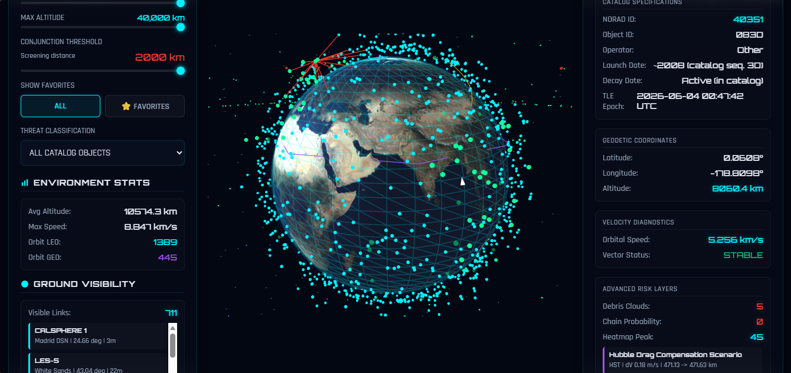

# SpaceRisk Radar Dashboard User Guide

**Summary:** The dashboard combines a Three.js globe with search, object
filters, propagated telemetry, conjunction screening, and analysis overlays.
The values describe the application's current data and simplified calculations,
not operational spaceflight advisories.

**Audience:** Readers and developers exploring a locally running instance.

*The screenshot is a genuine image from the original project repository. Its
displayed data may not represent a current catalog snapshot.*

## Find and inspect an object

1. Enter a name or part of a name in **Search Object** (examples shown in the
   interface include `ISS` and `STARLINK`).
2. Choose a result from the returned matches. The search API returns at most
   ten name matches; matching is case-insensitive.
3. Select the object on the globe or from search results to populate the
   telemetry panel. The backend record includes a name, catalog identifiers,
   TLE epoch, orbit classification, position, altitude, and speed.

The catalog-derived operator and launch fields include application-level
lookups or approximations. Do not treat them as authoritative identity data.

## Filter the globe

The left panel exposes controls for orbital environment (ALL, LEO, MEO, GEO),
country/agency, inclination, altitude, and favorite objects. These filters
change what is emphasized or shown in the client; they do not change the source
catalog or make the position estimate more accurate.

Use the globe controls to zoom in, zoom out, or reset the camera. The underlying
visualization is rendered by the JavaScript frontend and Three.js.

## Interpret close-approach results

The conjunction stream shows pairs whose same-time approximate separation is
under the selected threshold. The interface defaults to 500 km; its slider
spans 10–2,000 km. The backend clamps threshold changes sent by Socket.IO to
10–5,000 km.

Each result may show object names, a distance, a risk level, risk-factor text,
and a suggested maneuver string. The numeric `probability` and related levels
come from an unvalidated heuristic. This feature is a proximity visualization,
not collision prediction or maneuver guidance. Read [Understanding Satellite
Conjunction Screening](../articles/conjunction-screening.md) before interpreting
these fields.

## Explore time and analysis overlays

- **24-hour replay:** Use the timeline controls to select a time in the
  dashboard's replay window. The frontend requests propagated state using the
  `at` query parameter. Extrapolation far from a TLE epoch should be treated
  cautiously.
- **Ground visibility:** The backend evaluates the current catalog positions
  against five built-in station coordinates and a 10-degree minimum elevation
  angle. It selects the best visible station per object. The displayed duration
  is a rough formula, not a pass prediction.
- **Heatmap:** The backend groups objects into latitude, longitude, altitude,
  and orbit bins. Its normalized `risk_score` is a density ratio in the
  returned bins, not a collision-risk estimate.
- **Debris layer:** Displays hypothetical clouds from a small number of
  screened pairs. It is an illustrative deterministic scenario, not an
  evolving debris simulation.
- **Maneuver panel:** Uses hard-coded planning/scenario inputs and generated
  preview paths. It is not a verified operator schedule or maneuver product.
  The checked-in scenario dates are in June 2026 and have passed as of this
  portfolio's October 2026 review; the module filters out past entries, so the
  panel may be empty until those local inputs are updated.
- **Launch panel:** Uses Launch Library 2 when available; its plotted path is a
  generated visualization preview, not a flight trajectory.

Socket.IO events update the live objects, conjunctions, statistics, station
visibility, heatmap, debris-risk, and maneuver panels. If a browser cannot
connect to Socket.IO, the page may retry the connection; check the browser
console and `/health` if live panels remain empty.

## Account panel

The frontend includes signup, login, profile, watchlist, and preference
workflows backed by `/api/v1/` routes. Accounts are stored in local SQLite
unless configured otherwise. Do not enter a password you use elsewhere into a
locally hosted demonstration service. The default token-signing secret is for
development only; an exposed instance must be configured with a private
secret.

## Related references

- [API reference](../engineering/api-reference.md)
- [Data flow](../engineering/data-flow.md)
- [Glossary](../reference/glossary.md)
